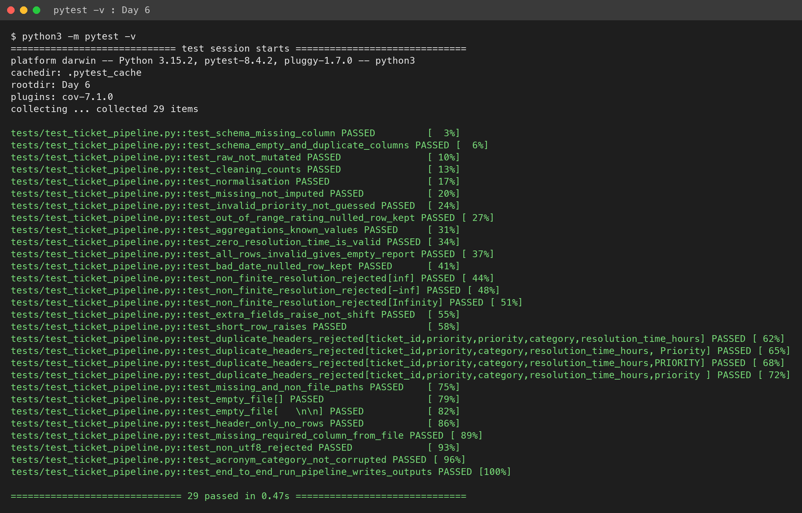
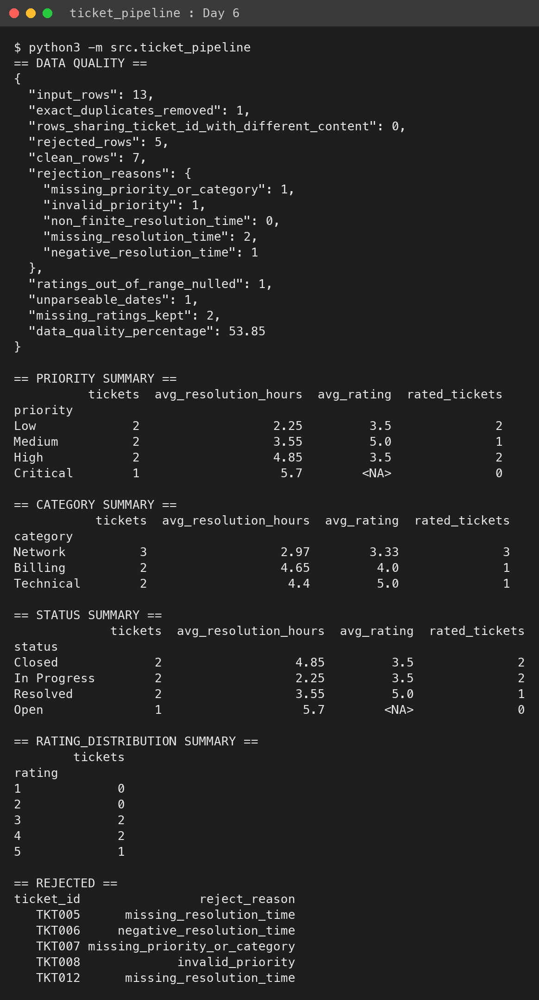

# Day 06 – Pandas Ticket Pipeline

Repeatable pipeline: **schema check → cleaning → aggregation report**.

## Setup / run
```
pip install -r requirements.txt
python3 -m src.ticket_pipeline [data/raw/tickets_raw.csv]   # writes data/processed/*
python3 -m pytest -v
```
Layout: `data/raw` (never modified) · `data/processed` (clean, rejected, summaries) · `src/ticket_pipeline.py` · `tests/` · `evidence/` (test + run output).

## Cleaning assumptions (also in the module docstring)
| Rule | Behaviour |
|---|---|
| Names/text | columns snake_cased; priority/status trimmed and Title-cased; blanks -> NA |
| Duplicates | exact duplicates dropped (first kept); same ticket_id with different content only flagged |
| Resolution time | non-numeric / negative / infinite / missing -> row **rejected**, never imputed; 0 is valid |
| Priority | must be Low/Medium/High/Critical; unknown values (e.g. "Urgent") rejected, not mapped |
| Category | missing -> rejected; case variants unified to most common spelling ("IT" stays "IT") |
| Input shape | `load_ticket_csv` raises `TicketDataError` for missing/empty/non-UTF-8 files, duplicate headers (raw or after normalization), and rows with the wrong field count, with no guessing or shifting |
| Rating | integer 1–5; missing kept as NA; out-of-range set to NA (row kept) |
| created_at | invalid -> NA (row kept) |

Rejected rows go to `tickets_rejected.csv` with a `reject_reason`, so nothing disappears silently.
Averages ignore NA ratings (and report `rated_tickets`), so missing is not treated as 0.

## Results
29 tests pass (`evidence/test_results.txt`). Sample run: 13 raw rows → 7 clean, 5 rejected, 1 duplicate removed, 53.85% quality (`evidence/pipeline_output.txt`).

## Screenshots



## Limitations
- Priority vocabulary is fixed; no fuzzy matching.
- Rows with a bad resolution time are dropped from all summaries, including rating, which may bias them.
- `created_at` is validated with the stdlib and kept as ISO strings, because `pd.to_datetime` segfaulted on this machine (Python 3.15 + pandas 2.3.3).
- `rating` is not in the Day 4 sample CSV, so a new messy `tickets_raw.csv` was created for this exercise.
